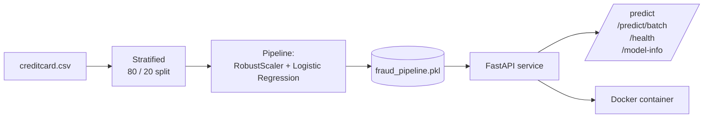

# 💳 Credit Card Fraud Detection API

A machine learning service that scores credit card transactions for fraud. A scikit-learn pipeline (RobustScaler + class-weighted logistic regression) is trained on the Kaggle credit card fraud dataset and served through a validated FastAPI REST API, packaged with Docker.


---

## Table of contents

- [Overview](#overview)
- [Architecture](#architecture)
- [Tech stack](#tech-stack)
- [Project structure](#project-structure)
- [Getting started](#getting-started)
- [API reference](#api-reference)
- [Modeling approach](#modeling-approach)
- [Results](#results)
- [Docker](#docker)
- [Known limitations](#known-limitations)
- [Roadmap](#roadmap)
- [Dataset and acknowledgements](#dataset-and-acknowledgements)

---

## Overview

Fraud is rare (about 0.17% of transactions in this dataset), so accuracy is a meaningless metric. This project:

- trains on a **stratified split** so train and test keep the same fraud ratio
- handles imbalance with **`class_weight="balanced"`**
- uses **RobustScaler**, which is less sensitive than StandardScaler to the heavy outliers in `Time` and `Amount`
- evaluates with **PR-AUC**, precision and recall rather than accuracy
- bundles the scaler and model into **one pipeline**, so serving applies exactly the same transforms as training

## Architecture



## Tech stack

| Area | Tools |
|---|---|
| Language | Python 3.11 |
| Modeling | scikit-learn, pandas, joblib |
| Serving | FastAPI, Pydantic v2, Uvicorn |
| Packaging | Docker (multi-stage build, non-root user, health check) |

## Project structure

```
fraud-api/
├── app/
│   ├── __init__.py
│   └── main.py              # FastAPI service
├── train.py                 # trains the pipeline, prints metrics, saves model
├── creditcard.csv           # Kaggle data (git-ignored, you download it)
├── fraud_pipeline.pkl       # generated by train.py
├── Dockerfile
├── requirements.txt
├── .gitignore
└── README.md
```

## Getting started

### 1. Clone and install

```bash
git clone https://github.com/<sharadyadav-ai>/fraud-api.git
cd fraud-api
python -m venv .venv
source .venv/bin/activate        # Windows: .venv\Scripts\activate
pip install -r requirements.txt
```

### 2. Get the data

Download `creditcard.csv` from the [Kaggle dataset](https://www.kaggle.com/datasets/mlg-ulb/creditcardfraud) and place it in the project root.

### 3. Train

```bash
python train.py
```

This prints a classification report and the PR-AUC, then saves `fraud_pipeline.pkl`.

### 4. Run the API

```bash
uvicorn app.main:app --reload
```

Interactive docs are available at <http://localhost:8000/docs>.

### Configuration

| Environment variable | Default | Description |
|---|---|---|
| `THRESHOLD` | `0.5` | Fraud probability at or above which `is_fraud` is true |
| `MODEL_PATH` | `./fraud_pipeline.pkl` | Path to the trained pipeline |
| `MODEL_VERSION` | `logreg-v1` | Label returned in responses |

Example: `THRESHOLD=0.9 uvicorn app.main:app` (PowerShell: `$env:THRESHOLD="0.9"`).

## API reference

| Method | Endpoint | Description |
|---|---|---|
| `GET` | `/health` | Liveness check and model-loaded status |
| `GET` | `/model-info` | Model version, pipeline steps, threshold, feature list |
| `POST` | `/predict` | Score a single transaction |
| `POST` | `/predict/batch` | Score 1 to 1000 transactions in one call |

### Example: score a real transaction

```python
import pandas as pd, requests

df = pd.read_csv("creditcard.csv")
features = [c for c in df.columns if c != "Class"]

row = df[df.Class == 1].iloc[0][features].to_dict()
print(requests.post("http://localhost:8000/predict", json=row).json())
```

Response shape:

```json
{
  "fraud_probability": 0.9731,
  "is_fraud": true,
  "threshold": 0.5,
  "model_version": "logreg-v1"
}
```

The values above are illustrative.

### Input schema

Each transaction needs 30 numeric fields: `Time`, `V1` to `V28` (anonymized PCA components), and `Amount`. `Time` and `Amount` must be 0 or greater. Missing or invalid fields return a `422` error. Every response carries an `X-Process-Time-ms` header.

## Modeling approach

| Decision | Rationale |
|---|---|
| **Stratified train/test split** | Keeps the same tiny fraud ratio in both sets, so test metrics are stable |
| **`class_weight="balanced"`** | Penalizes missed fraud more heavily without synthetic data |
| **RobustScaler** | Uses median and IQR, so it handles the extreme outliers in `Amount` and `Time` |
| **PR-AUC as the headline metric** | Robust under extreme class imbalance, unlike accuracy or ROC-AUC |
| **Single scikit-learn Pipeline** | Prevents train/serve skew |

## Results

Run `python train.py` and paste your output here.

| Metric | Value |
|---|---|
| PR-AUC (test) | _fill in_ |
| Fraud precision (threshold 0.5) | _fill in_ |
| Fraud recall (threshold 0.5) | _fill in_ |
| Fraud F1 (threshold 0.5) | _fill in_ |

## Docker

Train first so `fraud_pipeline.pkl` exists, then:

```bash
docker build -t fraud-api .
docker run -p 8000:8000 fraud-api
```

Pin `scikit-learn` in `requirements.txt` to the exact version you trained with (`pip show scikit-learn`). Loading a pickle under a different version can fail or behave differently.

## Known limitations

Being upfront about these is part of the project:

- **Random split, not time-based.** The model is evaluated on transactions that are interleaved in time with training data. A time-ordered split would better simulate production.
- **`Time` is used as a feature.** It is seconds since the first transaction in a two-day window, so it will not generalize to live traffic.
- **Fixed 0.5 threshold.** Balanced class weights usually give high recall but low precision at 0.5, meaning many legitimate transactions get flagged. The `THRESHOLD` setting lets you tune this, but it is not yet chosen on a validation set.
- **Anonymized features.** `V1` to `V28` are PCA outputs, so real inputs would need the same upstream transformation.
- **Linear baseline.** Gradient-boosted models typically do better on this dataset.

## Roadmap

- [ ] Time-ordered split and validation-based threshold selection
- [ ] Drop `Time`, or replace it with a feature that generalizes
- [ ] Compare against XGBoost / LightGBM
- [ ] pytest tests (API and model-quality gate)
- [ ] GitHub Actions CI: lint, test, build, push image
- [ ] Experiment tracking with MLflow
- [ ] SHAP-based explanations in the response
- [ ] Prometheus metrics and drift monitoring
- [ ] Cloud deployment (Cloud Run, ECS, or Render)

## Dataset and acknowledgements

Data: [Credit Card Fraud Detection](https://www.kaggle.com/datasets/mlg-ulb/creditcardfraud) by the Machine Learning Group, ULB, in collaboration with Worldline. It contains European cardholder transactions from two days in September 2013, with 492 frauds out of 284,807 transactions. Check the Kaggle page for license and citation terms. The dataset is not included in this repository.
