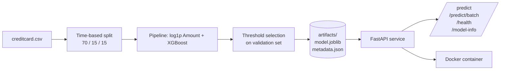

# 💳 Credit Card Fraud Detection API

A production-style machine learning service that scores credit card transactions for fraud in real time. It covers the full path from raw data to a containerized REST API: leakage-safe training, threshold selection against a business constraint, a validated FastAPI service, and Docker packaging.


---

## Table of contents

- [Overview](#overview)
- [Architecture](#architecture)
- [Tech stack](#tech-stack)
- [Project structure](#project-structure)
- [Getting started](#getting-started)
- [API reference](#api-reference)
- [Modeling approach](#modeling-approach)
- [Results](#results)
- [Docker](#docker)
- [Roadmap](#roadmap)
- [Dataset and acknowledgements](#dataset-and-acknowledgements)

---

## Overview

Fraud is rare (about 0.17% of transactions in this dataset), so accuracy is a meaningless metric. This project instead:

- optimizes for **PR-AUC** and reports **precision and recall** at a chosen operating point
- picks the decision threshold by a **business rule** (maximize recall subject to a minimum precision), not the default 0.5
- uses a **time-ordered split** so the model is never evaluated on data older than what it trained on
- bundles preprocessing and model in a single **scikit-learn `Pipeline`**, so training and serving apply identical transforms

## Architecture



## Tech stack

| Area | Tools |
|---|---|
| Language | Python 3.11 |
| Modeling | scikit-learn, XGBoost, pandas, NumPy |
| Serving | FastAPI, Pydantic v2, Uvicorn |
| Packaging | Docker (multi-stage build, non-root user, health check) |

## Project structure

```
fraud-api/
├── app/
│   ├── __init__.py
│   └── main.py            # FastAPI service
├── src/
│   └── train.py           # training, thresholding, evaluation
├── data/                  # place creditcard.csv here (not committed)
├── artifacts/             # generated: model.joblib, metadata.json
├── Dockerfile
├── requirements.txt
└── README.md
```

## Getting started

### 1. Clone and install

```bash
git clone https://github.com/<your-username>/fraud-api.git
cd fraud-api
python -m venv .venv
source .venv/bin/activate        # Windows: .venv\Scripts\activate
pip install -r requirements.txt
```

### 2. Get the data

Download `creditcard.csv` from the [Kaggle dataset](https://www.kaggle.com/datasets/mlg-ulb/creditcardfraud) and place it in `data/`.

### 3. Train

```bash
python src/train.py --data data/creditcard.csv --min-precision 0.90
```

| Flag | Default | Description |
|---|---|---|
| `--data` | `data/creditcard.csv` | Path to the dataset |
| `--out` | `artifacts` | Output directory for the model and metadata |
| `--min-precision` | `0.90` | Precision floor used to choose the threshold |
| `--version` | `v1` | Version label stored in metadata |

### 4. Run the API

```bash
uvicorn app.main:app --reload
```

Interactive docs are available at <http://localhost:8000/docs>.

## API reference

| Method | Endpoint | Description |
|---|---|---|
| `GET` | `/health` | Liveness check and model-loaded status |
| `GET` | `/model-info` | Model version, threshold, test metrics, feature list |
| `POST` | `/predict` | Score a single transaction |
| `POST` | `/predict/batch` | Score 1 to 1000 transactions in one call |

### Example: single prediction

```bash
curl -X POST http://localhost:8000/predict \
  -H "Content-Type: application/json" \
  -d "$(python -c "import json; d={f'V{i}':0.0 for i in range(1,29)}; d['Amount']=149.62; print(json.dumps(d))")"
```

Response:

```json
{
  "fraud_probability": 0.000412,
  "is_fraud": false,
  "threshold": 0.83,
  "model_version": "v1"
}
```

The values above are illustrative. The real threshold comes from your trained model.

### Input schema

Each transaction needs 29 numeric fields: `V1` to `V28` (anonymized PCA components, as provided in the Kaggle dataset) and `Amount` (must be 0 or greater). Missing or non-numeric fields return a `422` validation error.

Every response includes an `X-Process-Time-ms` header with server-side latency.

## Modeling approach

| Decision | Rationale |
|---|---|
| **PR-AUC as the main metric** | Robust under extreme class imbalance, unlike accuracy or ROC-AUC |
| **Time-ordered split** | Mimics production: train on the past, evaluate on the future |
| **Threshold tuned on validation, reported on test** | Keeps the test set untouched, so reported numbers are honest |
| **`scale_pos_weight` instead of SMOTE** | Simple, no synthetic data leakage risk, works well with gradient boosting |
| **`Time` column dropped** | It is seconds since the first transaction in a two-day window and will not generalize |
| **`log1p(Amount)`** | Amount is heavily right-skewed |
| **Preprocessing inside the pipeline** | Prevents train/serve skew |

## Results

Run `python src/train.py` and paste your numbers here. The script prints them and saves them to `artifacts/metadata.json`.

| Metric | Value |
|---|---|
| PR-AUC (test) | _fill in_ |
| Precision at threshold | _fill in_ |
| Recall at threshold | _fill in_ |
| Decision threshold | _fill in_ |
| Test rows / fraud rows | _fill in_ |

## Docker

Train first so `artifacts/` exists, then:

```bash
docker build -t fraud-api .
docker run -p 8000:8000 fraud-api
```

The image uses a multi-stage build, runs as a non-root user, and includes a health check against `/health`.

## Roadmap

- [ ] Unit and API tests with pytest, plus a model-quality gate (fail if PR-AUC drops)
- [ ] GitHub Actions CI: lint, test, build, push image
- [ ] Experiment tracking and model registry with MLflow
- [ ] Hyperparameter tuning with Optuna
- [ ] SHAP-based top reasons in the prediction response
- [ ] Prometheus metrics and Grafana dashboard
- [ ] Data and prediction drift reports with Evidently
- [ ] Cloud deployment (Cloud Run, ECS, or Render)

## Dataset and acknowledgements

Data: [Credit Card Fraud Detection](https://www.kaggle.com/datasets/mlg-ulb/creditcardfraud) by the Machine Learning Group, ULB, in collaboration with Worldline. It contains European cardholder transactions from two days in September 2013, with 492 frauds out of 284,807 transactions. Please check the Kaggle page for license and citation terms before redistributing.

The dataset is not included in this repository.
# Credit-Card-fraud-detection
